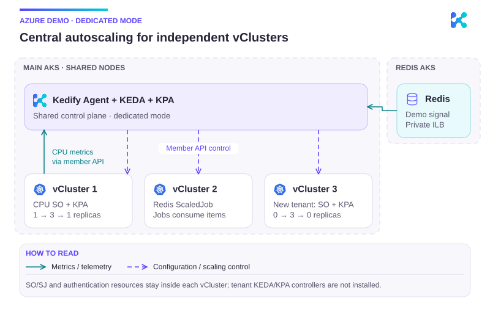

# Kedify vCluster + KPA demo

This repository creates a disposable Azure environment for demonstrating one
central Agent/KEDA/KPA installation scaling workloads in automatically
discovered vClusters. The prepared state contains two connected vClusters; the
third is created live to demonstrate discovery, bootstrap, registration, and
connection lifecycle. Redis runs in a second AKS cluster on the same virtual
network and is exposed through an internal load balancer.

## Topology



```text
Azure resource group
└── virtual network
    ├── main AKS: 3 x Standard_D8s_v5
    │   ├── Kedify Agent
    │   ├── KEDA
    │   ├── KPA
    │   ├── vCluster 1 (prepared)
    │   ├── vCluster 2 (prepared)
    │   └── vCluster 3 (created during the presentation)
    └── Redis AKS: 2 x Standard_D4s_v5
        └── Redis behind an internal load balancer
```

## Prerequisites

- Azure CLI authenticated with `az login`
- permission to create resource groups, role assignments, AKS, and network resources
- Helm, kubectl, the vCluster CLI, Make, OpenSSL, Python 3.9 or newer, and GNU `timeout`
- iTerm2 and zsh for the native macOS presentation; `watch` for the extra Deployment tab
- tmux only if using the optional tmux layout
- sufficient regional quota for 32 general-purpose vCPUs

Copy `.env.example` to `.env`, set `KEDIFY_ORG_ID` and `KEDIFY_API_KEY`, and
adjust the Azure region, Kubernetes version, or released chart version if
necessary. `KEDIFY_AGENT_ID` is optional; when omitted, Agent uses the
management cluster's immutable identity.
On macOS, Homebrew coreutils supplies GNU `timeout`; make sure its `libexec/gnubin`
directory is on `PATH`. Keep `.env`, `.kube/`, and `state/` local; the sample's
ignore rules also exclude environment-file backups and Python bytecode.

## Getting the kubeconfigs

This is the first step after cloning the repository when the Azure
infrastructure already exists. Log in to Azure, select the subscription that
contains the demo resource group, and download credentials for both physical
AKS clusters:

```bash
az login
az account show --output table
# If necessary:
az account set --subscription <subscription-id-or-name>

cp .env.example .env
# Configure RESOURCE_GROUP and DEPLOYMENT_NAME in .env if they differ from
# the defaults, then configure the Kedify credentials used by make platform.

make credentials
```

`make credentials` reads the main and Redis AKS names from the existing Bicep
deployment outputs and writes two separate files:

| File | Cluster | Used for |
| --- | --- | --- |
| `.kube/main.yaml` | management AKS | Agent/KEDA/KPA, vCluster Helm releases, registrations, and host-side connectivity checks |
| `.kube/redis.yaml` | Redis AKS | Redis deployment, queue manipulation, and Redis health checks |

The files are mode `0600`, are ignored by Git, and do not replace the user's
default kubeconfig. To confirm that the credentials point to the expected
clusters:

```bash
kubectl --kubeconfig .kube/main.yaml get nodes
kubectl --kubeconfig .kube/redis.yaml get nodes
```

You can add the main cluster kubeconfig to your current terminal

```
export KUBECONFIG=.kube/main.yaml
```

The ignored `state/` directory is also not included in a clone. After getting
the kubeconfigs for an existing deployment, reconstruct its Redis endpoint and
password from the Redis cluster:

```bash
make redis-state
```

This reads the existing `redis-auth` Secret and internal LoadBalancer Service,
then writes `state/redis-password` and `state/redis-ip` with mode `0600`. It
does not print the password. Only use this command from a trusted workstation;
access to `.kube/redis.yaml` grants access to the credential stored in the
cluster.

For a brand-new environment, `make infra` creates the Azure resources and
runs the same credential-download step automatically. Running
`make credentials` before the Bicep deployment exists will fail because there
are no deployment outputs from which to obtain the AKS names.

The demo deliberately does not store one kubeconfig per vCluster. Its helper
commands use the vCluster CLI with `.kube/main.yaml`, for example:

```bash
KUBECONFIG=.kube/main.yaml \
  vcluster connect vc-1 --namespace vcluster-1 \
  --background-proxy=false -- kubectl get nodes
```

This also mirrors the presentation topology: the vCluster control planes are
hosted in the management AKS cluster, while Agent discovers their credentials
and creates the `ClusterRegistration` resources consumed by KEDA and KPA.

## Deployment

Run each stage separately during development:

```bash
make infra
make platform
make vclusters
make redis
make verify
```

Or run the complete deployment:

```bash
make deploy
make verify
```

The deployment provisions infrastructure, installs released `kedify-agent`
chart `v0.8.2` (including its KEDA and KPA dependencies), discovers and
bootstraps two vClusters, and exposes Redis privately. It intentionally does
not create the third vCluster.

The management cluster hosts Agent, KEDA, KPA, and the vCluster control planes,
but it is not registered as a scaling target. Only automatically discovered
vClusters are reconciled by the dedicated multicluster runtime.

The management AKS cluster defaults to Kubernetes `1.35.8`, within KPA `0.2.1`'s
supported Kubernetes `1.33`–`1.35` range. Override
`MAIN_KUBERNETES_VERSION` only with another version supported by both AKS in
the selected region and the bundled KPA release.

## Presentation flow

### Manual presentation in iTerm2 on macOS

The presentation uses three native iTerm2 views: observers, Deployment watches,
and interactive resource shells. Commands work from zsh; the helpers use Bash.
The observer view has a full-width host pane above three tenants. For visible
manual commands, add a fifth full-width pane below them in iTerm2, or use the
separate control tab created by the launcher.

Before rehearsal, recover credentials/state if this is a fresh checkout, then
restore the two-vCluster baseline:

```bash
make credentials
make redis-state
make demo-baseline
```

`demo-baseline` removes only the `demo-scaling` fixtures and the third vCluster,
then prepares an idle CPU Deployment in vc-1 and an authenticated ScaledJob in
vc-2. It does not recreate Azure infrastructure or the central controllers.
`make demo-preflight` verifies this state without changing cluster resources.
It waits for CPU samples whose measurement windows are usable by KPA, as well
as `ScalingActive=True`, so the first CPU step starts from a sampled idle Pod.

Create the observer/control workspace, then add the other two views:

```bash
make demo-iterm2
make demo-iterm2-extras
```

Each launcher appends tabs. Run it once, then reuse the panes across reset cycles.

Open one iTerm2 tab, enlarge its font before splitting, and create a full-width
top pane plus three lower panes. Use at least 150 columns and 42 rows for the
whole tab (180 × 46 is comfortable); resize the window and font together so the
replica counts and headings remain visible:

`make demo-iterm2` is an optional macOS launcher using iTerm2's documented
[AppleScript interface](https://iterm2.com/documentation-scripting.html). It
creates a new observer tab with the four panes and a separate manual-control
tab, sizes those sessions for readability, and starts only the read-only
observers and help. Existing tab commands and profile preferences are untouched.
macOS may ask you to allow the invoking app to control iTerm2. Review
`scripts/demo-iterm2.applescript` before running it. You can also create the
layout manually:

1. Split horizontally with **Cmd+Shift+D**. The top pane is the host view.
2. Focus the lower pane and split vertically with **Cmd+D** twice to obtain
   three tenant panes. Drag the dividers to give the tenants equal widths.
3. In every pane, change into `examples/samples/multicluster-vcluster`.
4. Run one command per pane:

| Pane | Command |
| --- | --- |
| Top, full width | `make demo-pane PANE=host` |
| Lower left | `make demo-pane PANE=1` |
| Lower middle | `make demo-pane PANE=2` |
| Lower right | `make demo-pane PANE=3` |

Use iTerm2's session titles to label the panes if desired. The observer also
prints its cluster identity inside every pane. The vc-3 pane waits until that
member exists. Press **Ctrl+C in each pane** to stop observation and close its
connection. Observation uses explicit contexts and never switches the default
kubeconfig. It writes only sanitized, ignored summaries in `state/observer`.
Stop an existing observer layout before launching another; the native and tmux
layouts use the same per-member ports and should not run concurrently.
Errors, stale samples, and a new registration UID invalidate counts rather than
being displayed as zero. `DEMO_REFRESH_SECONDS=3` controls refresh frequency;
`NO_COLOR=1` disables colors for accessible or plain-text output.
Green highlights ready/converged values and successful Jobs; cyan highlights
desired replicas and active work; amber highlights queued demand, transitions
and unknown values; red highlights failures. Explanatory text is muted.

In the control tab, run these steps separately, leaving time for discussion:

You can instead type these commands in an extra lower pane in the observer
tab, so the audience can see the command and its result together.

```bash
make demo-cpu-on       # vc-1: 1 -> 3 ready replicas
make demo-cpu-off      # vc-1: back to its minimum of one
make demo-jobs         # vc-2: enqueue three items; Jobs consume them
make third-vcluster   # live discovery, CRD bootstrap, registration
make demo-workload    # developer-owned ordinary ScaledObject in vc-3
make demo-queue-on     # nine Redis items -> three vc-3 replicas
make demo-queue-off    # remove simulated demand -> scale to zero
```

`make demo-help` displays the controls. No manual action automatically schedules
the next one or clears demand on a timer. Job history remains visible, and the
observer distinguishes active, succeeded, and failed Jobs. CPU commands toggle
load inside an existing Pod without changing the Deployment template. Newly
scaled Pods start idle; one 500m load source is enough to reach the maximum of
three. Turning load off clears it in all running worker Pods. The command names
remain the same. After initial setup or a baseline reset, preflight waits until
CPU measurement windows are usable by KPA, rather than merely visible in `top`.
The vc-1 observer replaces the two known startup metric failure reasons with
“Collecting CPU metrics…” for at most 150 seconds. Actual conditions remain
visible; persistent, permission and connectivity failures keep their KPA reason.
The vc-3 placeholder Deployment does not consume Redis; clearing its list is an
explicit simulation of demand disappearing. vc-2 demonstrates real consumption.

The host pane combines host registration/component status with sanitized member
observations. Dedicated mode keeps SO/SJ/KPA resources inside their members;
they are not mirrored host resources. Registration readiness validates access,
while KPA conditions and Deployment/Job observations demonstrate reconciliation.

Useful repeat/reset controls, run from the manual command pane:

| Command | Effect |
| --- | --- |
| `make demo-jobs-clear` | Clear vc-2 queued demand; Jobs that fetched work may finish |
| `make demo-jobs-reset` | Clear vc-2 demand, remove its Jobs and recreate the ScaledJob fixture |
| `make demo-queue-off` | Clear vc-3 backlog and wait for zero worker replicas |
| `make demo-queue-clear` | Clear vc-3 backlog even if the tenant or worker is absent |
| `make demo-tenant-reset` | Clear vc-3 backlog, uninstall vc-3 and wait for its generated registration to disappear |
| `make demo-baseline` | Restore the two-tenant idle baseline, removing vc-3 and all demo Job history |

After a Jobs reset, run `make demo-jobs` again. After a tenant reset, run
`make third-vcluster`, then `make demo-workload`. Discovery owns the generated
registration lifecycle. `make reset-third-vcluster` remains available as the
underlying tenant removal command; `demo-tenant-reset` also clears Redis demand.

### Extra Deployment and resource tabs

Run `make demo-iterm2-extras` once to append two native tabs without changing
your existing panes. It requires `watch` (`brew install watch` if missing).

- **Deployments:** host above three tenants. Each pane runs `watch` every two
  seconds around `kubectl get deployments --all-namespaces`. The host has the
  central Agent/KEDA/KPA Deployments; tenant views show their local workloads
  and replica changes. Host-synced tenant Deployments may also appear on the host.
- **Resources:** a 2 × 2 layout: host upper left, vc-1 upper right, vc-2 lower
  left, vc-3 lower right. Each pane opens a clean interactive zsh and lists its
  ScaledObjects/ScaledJobs first. Type ordinary `kubectl` commands here; in tenant
  panes a shell function connects afresh for every command, fetching current
  credentials. The host uses `keda` and workloads use `demo-scaling`.

The vc-3 panes wait for registration and connect automatically after
`make third-vcluster`. Deployment watches use ports 18541–18543, separate from
the observer ports, and monitor registration identity to reconnect after tenant
recreation. Resource commands use temporary connections on random free ports.
Stop the observer/watch panes before creating another copy. Use
**Ctrl+C** to stop a Deployment watch; type `exit` to close a connected resource
shell (or Ctrl+C while it is still waiting). User startup files and the default
kubeconfig are unchanged; only the resource shell uses the supplied demo zshrc.
For manual layout, run `make demo-deployments PANE=host`
or `make demo-resources PANE=host`, using `PANE=1`, `2`, and `3` in tenant panes.

Leave all tabs running during Jobs resets and `demo-baseline`. Resources may
briefly disappear while namespaces/fixtures are recreated. Removing/recreating
vc-3 makes its observer and Deployment watch wait and reconnect automatically;
its existing resource shell remains usable, and the next `kubectl` command
fetches the new credentials after registration is Ready. A command issued while
vc-3 is absent fails visibly; retry when Ready. A manually started long-running
`kubectl --watch` command may need Ctrl+C and a rerun after tenant recreation,
but the resource shell and tab do not need to be recreated.

Useful inspection commands:

```bash
# Host resource pane
kubectl -n keda get clusterregistrations
kubectl -n keda get deployments

# Each tenant resource pane
kubectl -n demo-scaling get scaledobject,scaledjob,kpa
kubectl -n demo-scaling get deployments,jobs,pods
```

For Dashboard presentation, use **Components**, **Multi-Cluster**, then select
**Include member clusters** separately on the ScaledObjects and ScaledJobs lists.
Member resources are read-only. Open a resource to inspect its member identity
and conditions. The three `worker` resources deliberately share a namespace and
name so the cluster column matters.

For the optional tmux layout, run `make demo-tmux` in a sufficiently large
terminal. It opens the same host/three-tenant layout and a separate `control`
window. Switch windows with **Ctrl+B, n** or **Ctrl+B, p**. Stop the whole session
with `tmux kill-session -t kedify-vcluster-demo`; attaching to an existing session
uses `tmux attach -t kedify-vcluster-demo`. Session options are local and do not
modify the user's tmux configuration.

Run `make demo-check` for offline regression checks of observer freshness,
registration identity, Job Pod ownership, and replica waits. These checks do not
access Azure. Shell syntax can also be checked with `bash -n scripts/demo-*.sh`;
use `shellcheck -P scripts -x scripts/demo-*.sh scripts/scaling-common.sh` when
ShellCheck is installed.

The architecture asset is
[`assets/azure-vcluster-redis-topology.svg`](assets/azure-vcluster-redis-topology.svg).
Its source is `marketing/design/diagrams/vcluster-demo.mjs` in the sibling
marketing repository. Follow `marketing/design/diagrams/README.md`, regenerate
with `npm run diagrams:generate`, run `npm run diagrams:check`, and copy the
generated `packages/docs/public/assets/images/docs/azure-vcluster-demo.svg`
here. Do not hand-edit the exported SVG.

### Existing automated presentation

Before the presentation, prepare and verify the stable two-cluster baseline:

```bash
make deploy
make prepare-scaling-demo
make verify
```

Create the third vCluster live:

```bash
make third-vcluster
```

This command first proves that the two existing registrations are Ready. It
then displays a live watch while Helm creates `vc-3`. The audience sees Agent
discover the vCluster, install the required KEDA/KPA CRDs, create the generated
kubeconfig Secret and `ClusterRegistration`, and finally report `Ready=True`.
Afterward, verify the complete three-cluster state with:

```bash
EXPECTED_VCLUSTERS=3 make verify
```

Then run the remote-scaling portion:

```bash
make present-scaling
```

The scaling presentation uses one resource-metrics scenario and two independent
Redis lists so demand and autoscaling state cannot leak between vClusters:

| vCluster | Remote resource | Input | Expected result |
| --- | --- | --- | --- |
| `vc-1` | CPU `ScaledObject` + KPA | CPU load enabled | 3 Deployment replicas |
| `vc-2` | authenticated `ScaledJob` | 3 Redis items | remote Jobs are created |
| `vc-3` | `ScaledObject` + KPA | 9 Redis items | 3 Deployment replicas |

### Scenario 1: an existing ScaledObject in vc-1

`make prepare-scaling-demo` creates a one-replica `worker` Deployment and a
CPU-backed `ScaledObject` in `vc-1`. The vCluster proxies its host cluster's
PodMetrics API, allowing central KPA to read CPU usage through the registered
`vc-1` Kubernetes API. The worker initially sleeps and remains at one replica.
During the presentation, the script enables a file-controlled CPU-bound loop
inside the existing worker Pods, without replacing them. Each Pod is limited to
500m CPU against a 100m request and the target is 50% utilization. One busy Pod
already demands more than the configured maximum of three replicas, even though
newly scaled Pods start idle. Disabling the load removes the control file from
all running worker Pods and KPA returns the Deployment to its minimum of one.
Load state is recorded on Deployment metadata, outside its Pod template. Applying
the updated fixture for the first time rolls out its new worker command once;
subsequent on/off cycles do not roll the Deployment.
The loaded Pod gets a higher deletion cost so scale-down prefers to keep the
already sampled worker for the next cycle.

This scenario shows steady-state reconciliation for a vCluster that was
connected before the presentation:

```text
vc-1 ScaledObject -> remote metrics.k8s.io CPU samples
                  -> central KPA -> vc-1 Deployment (1 -> 3 -> 1 replicas)
```

### Scenario 2: an authenticated ScaledJob in vc-2

The prepared `vc-2` fixture is a `ScaledJob`, not a `ScaledObject`. Its
`TriggerAuthentication` reads the Redis address and password from a Secret in
`vc-2`. With a target of one queue item per Job, three items cause KEDA's
remote ScaledJob loop to create Jobs in `vc-2` (up to the configured maximum
of three). Each Job authenticates to Redis and removes one item with `RPOP`.
ScaledJobs do not create a KPA.

This separately demonstrates remote authentication lookup, Secret-based
scaler construction, and native KEDA Job creation:

```text
vc-2 ScaledJob -> central KEDA -> Redis list length (3)
                              -> Jobs in vc-2 -> RPOP one item per Job
```

### Scenario 3: immediate scaling after vc-3 discovery

`vc-3` does not exist in the prepared baseline. `make third-vcluster` creates
it live and waits while Agent discovers it, bootstraps its CRDs, and publishes
a ready registration. `make present-scaling` then creates a Deployment,
`TriggerAuthentication`, and `ScaledObject` in this newly registered cluster.
Nine items with the same three-items-per-replica target produce three replicas.

This combines the lifecycle and scaling stories: a newly discovered cluster
becomes usable by KEDA and KPA without restarting either controller or
manually supplying a kubeconfig.

```text
create vc-3 -> automatic registration -> remote ScaledObject
            -> central KEDA -> Redis list length (9)
                            -> remote KPA -> vc-3 Deployment (3 replicas)
```

After holding the scaled state for 20 seconds, the script disables `vc-1` CPU
load and clears the `vc-3` Redis queue. This demonstrates CPU scale-down to the
minimum replica count and external-metric scale-to-zero side by side. Set
`DEMO_HOLD_SECONDS` to keep the scaled state visible for longer.

## Remote KPA resource-metrics integration

CPU and memory scaling follow a different path from Redis and other external
KEDA scalers. KPA reads the Kubernetes Resource or ContainerResource metric
directly from the API of the cluster containing the workload:

```text
vc-1 worker Pod
      |
      | CPU usage collected by the host AKS metrics-server
      v
vc-1 metrics.k8s.io API
      |
      | remote Kubernetes client from ClusterRegistration
      v
KPA in the management AKS cluster
      |
      | desired replica calculation and remote /scale update
      v
vc-1 worker Deployment
```

The vClusters use the host AKS metrics-server instead of installing a separate
metrics-server in every tenant cluster. This uses the
[vCluster metrics-server integration](https://www.vcluster.com/docs/vcluster/configure/vcluster-yaml/integrations/metricsServer)
and is enabled in `values/vcluster.yaml`:

```yaml
integrations:
  metricsServer:
    enabled: true
    nodes: false
    pods: true
```

These are values for the vCluster Helm chart, not values for KPA or the
Kedify Agent chart. The shared `install_vcluster` helper in
`scripts/vcluster-common.sh` passes the file to every vCluster release:

```text
helm upgrade --install "${name}" vcluster \
  ... \
  --values "${REPO_ROOT}/values/vcluster.yaml"
```

The same helper installs the prepared `vc-1` and `vc-2` releases and the live
`vc-3` release. This guarantees that a vCluster created during the presentation
has the same PodMetrics capability as the prepared clusters.

`integrations.metricsServer.enabled: true` registers a metrics API in the
virtual cluster that reuses the metrics-server running in the host AKS
cluster. It is intentionally different from:

```yaml
deploy:
  metricsServer:
    enabled: true
```

The latter would deploy a separate metrics-server add-on for the tenant
cluster. This demo uses the integration because the vClusters run with shared
host nodes and AKS already provides a healthy metrics-server.

Only PodMetrics are exposed because KPA needs workload metrics, while the demo
does not need to expose host NodeMetrics to its tenants. The management AKS
cluster must therefore have a healthy `metrics.k8s.io` API and the default
`kube-system/metrics-server` Service expected by this integration.

This setting is part of the vCluster Helm release. After adding or changing it
for already-running vClusters, apply the update with:

```bash
make vclusters
```

The command upgrades `vc-1` and `vc-2` in place. Newly created `vc-3` receives
the same configuration automatically. `make prepare-scaling-demo` also waits
for the `vc-1` metrics API before creating the CPU scenario, so a missing
integration fails during preparation rather than during the presentation.

Check the physical AKS metrics API with:

```bash
kubectl --kubeconfig .kube/main.yaml \
  get apiservice v1beta1.metrics.k8s.io
```

Check the API exposed inside `vc-1` with:

```bash
KUBECONFIG=.kube/main.yaml \
vcluster connect vc-1 --namespace vcluster-1 --background-proxy=false -- \
  kubectl get --raw /apis/metrics.k8s.io/v1beta1
```

Once the worker Pod is running, inspect its current sample with:

```bash
KUBECONFIG=.kube/main.yaml \
vcluster connect vc-1 --namespace vcluster-1 --background-proxy=false -- \
  kubectl --namespace demo-scaling top pods
```

If this integration is missing or unavailable, KPA retains the current replica
count and records `FailedGetMetric` on the remote KPA. Inspect it with:

```bash
KUBECONFIG=.kube/main.yaml \
vcluster connect vc-1 --namespace vcluster-1 --background-proxy=false -- \
  kubectl --namespace demo-scaling describe \
  kedifypodautoscaler worker-autoscaler
```

There is no fallback to PodMetrics from a same-name workload in the management
cluster. The registered vCluster API remains the identity and isolation
boundary for Pods, metrics, and `/scale` writes.

## How KEDA reaches Redis

Both AKS clusters are attached to the same Azure virtual network but use
different subnets:

```text
Azure VNet 10.10.0.0/16
├── main-aks subnet  10.10.0.0/20
│   ├── KEDA Pod
│   └── vCluster workload Pods
└── redis-aks subnet 10.10.16.0/24
    └── internal LoadBalancer -> Redis Service -> Redis Pod
```

The Redis Service has the Azure internal-load-balancer annotation, so Azure
assigns it a private frontend IP rather than a public address. No VNet peering
or cross-cluster Service DNS is involved: the clusters already share one VNet,
and clients connect directly to the internal load balancer's private IP on
port `6379`.

`make redis` waits for that private IP and stores it in `state/redis-ip`. It
also generates the Redis password in `state/redis-password`; both files are
ignored by Git. `make prepare-scaling-demo` first launches a temporary
`redis-cli` Pod in the main AKS cluster and requires a successful `PING`. This
proves the network path before any scaling resources are created.

The scripts create a `redis-auth` Secret independently inside `vc-2` and
`vc-3`. The Secret contains the private address and password. For the `vc-3`
`ScaledObject`, central KEDA reads that Secret through the registered remote
Kubernetes client, builds the Redis scaler, and opens the TCP connection from
the KEDA Pod in the main cluster:

```text
vc-3 Secret --read through remote API--> KEDA in main AKS
                                          |
                                          | TCP, private VNet, :6379
                                          v
                                 Redis internal load balancer
```

The Redis endpoint therefore must be reachable from the management cluster;
a Redis Service name that resolves only inside the Redis cluster would not
work. In the ScaledJob scenario, the Jobs also receive the private host and
password from their vCluster Secret and connect to the same internal load
balancer to consume queue items.

To rehearse the lifecycle again, remove only the third vCluster and its
generated registration:

```bash
make reset-third-vcluster
make verify
```

To remove the scaling resources and clear their Redis queues without deleting
the AKS clusters or vClusters:

```bash
make reset-scaling-demo
```

## Destruction

Destruction requires the resource-group name as an explicit guard:

```bash
CONFIRM_DESTROY=kedify-vcluster-kpa-demo make destroy
```
