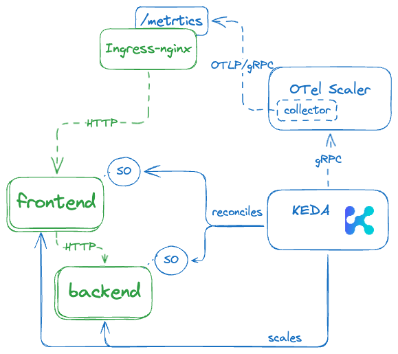

This sample expects an existing, vendor-supported Ingress NGINX-compatible controller that provides `nginx_ingress_controller_connect_duration_seconds_count`. Verify that its image carries the fixes in the [NGINX security advisories](https://nginx.org/en/security_advisories.html) and that the metrics Service is reachable. The [community ingress-nginx controller was retired](https://kubernetes.io/blog/2025/11/11/ingress-nginx-retirement/).

# Setup
1. install the Apollo Router backend

```
helm upgrade --install my-app-be \
   --namespace app \
   --create-namespace \
   oci://ghcr.io/apollographql/helm-charts/router \
   -f ./apollo-values.yaml
```

2. Verify that the existing metrics Service is available. If you use a different service name or namespace, update both the preflight check in `setup.sh` and the scrape target in `otel-scaler-values.yaml`.

```bash
kubectl -n ingress-nginx get service ingress-nginx-controller-metrics
```

3. install the OTel Scaler

```
helm upgrade --install keda-otel-scaler \
   --namespace keda \
   --create-namespace \
   oci://ghcr.io/kedify/charts/otel-add-on \
   --version=v0.1.3 \
   -f ./otel-scaler-values.yaml
```

4. create the demo app and ScaledObjects

```
kubectl apply -f fe.yaml -f be-so.yaml -f fe-so.yaml
```

# Architecture


[Source diagram](https://excalidraw.com/#json=VzaunOMs2NXOd_rTVy2yl,RU1vtVumsMIw-PxaUETKKw)
